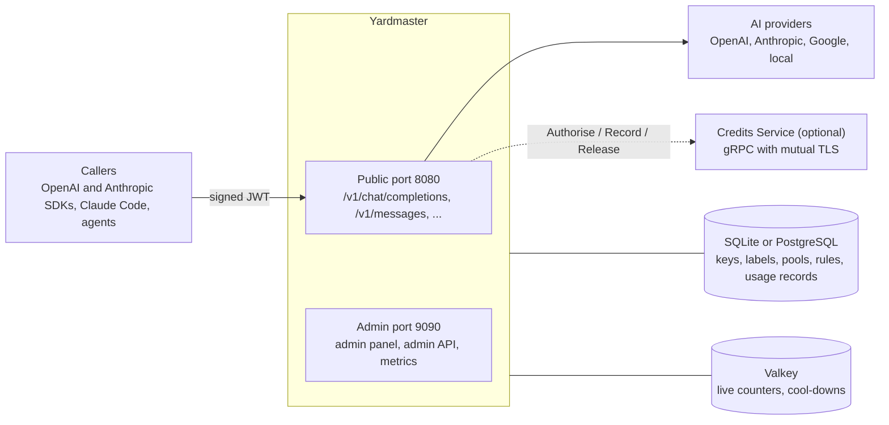

# Yardmaster

[](https://github.com/james-g7/yardmaster/actions/workflows/ci.yml)
[](LICENSE)


**An open-source AI gateway that routes every call to the right model and
key, and keeps every key inside its usage rules.**

Yardmaster sits between your projects and the AI providers they use. Callers
speak the OpenAI or Anthropic wire format and present a signed JWT. Yardmaster
picks a model and a provider key for each request, keeps that key within its
rate and token limits, streams the reply back in the caller's format, and
records what was used. Provider keys never leave it. Prompts and replies are
never stored.

> **Status: early.** Build step 1 of 12 (foundations) is done: the service
> starts, runs its migrations on SQLite or PostgreSQL, and reports ready once
> the database and Valkey answer. There is no proxying yet. See
> [Build steps](#build-steps) for what comes next.

## Contents

- [Why Yardmaster](#why-yardmaster)
- [Quick start](#quick-start)
- [How it works](#how-it-works)
- [Caller API](#caller-api)
- [Configuration](#configuration)
- [Deployment](#deployment)
- [Security](#security)
- [Development](#development)
- [Build steps](#build-steps)
- [Design docs](#design-docs)
- [License](#license)

## Why Yardmaster

- **Many callers, few keys.** Agents, scripts and apps share a handful of
  provider accounts. Yardmaster is the one place that knows every key's
  limits and refuses to let any caller push a key past them.
- **Callers ask for a label, not a model.** A caller sends `model: "fast"`;
  you decide what "fast" means today. Swap models, add keys or move providers
  without touching a single client.
- **Graceful overflow.** Each label has priority pools. When pool 1 is full,
  traffic spills to pool 2 and comes back when there is room. When nothing
  has room, callers get a 503 with `Retry-After`, or a fallback label.
- **One format in, any provider out.** OpenAI- and Anthropic-compatible
  endpoints on the front, OpenAI, Anthropic, Google and local adapters on the
  back. Claude Code and an OpenAI SDK can share one label.
- **Billing is someone else's job.** A small gRPC hook lets an external
  Credits Service authorise and settle every call. Without one, Yardmaster
  just routes.
- **Nothing to leak.** Keys are encrypted at rest and never returned. No
  prompt or reply content is written to the database or logs.

## Quick start

You need Docker with Compose.

```bash
docker compose -f deploy/docker-compose.yml up --build
```

```bash
curl localhost:8080/readyz
```

`readyz` answers `ok` once the database and Valkey are both reachable. This
runs one Yardmaster with SQLite on a volume, plus Valkey. Only the public API
port (8080) is published. The admin port (9090) stays inside the Compose
network.

To run from source instead, see [Development](#development).

## How it works

### Concepts

| Term | Meaning |
|---|---|
| **Provider** | An upstream API: OpenAI, Anthropic, Google, or anything OpenAI-compatible such as a local model server. |
| **Provider key** | One credential for a provider, encrypted at rest, with its own abilities and usage rules. |
| **Model** | A provider's model name tied to the key it is called with. |
| **Label** | What a caller asks for. A label has rules (max context, max output, allowed features), an optional fallback label, and per-label caller limits. |
| **Pool** | A numbered priority group of models and keys behind a label. Lower numbers are tried first. |
| **Rule preset** | A named set of limits (requests per minute, hour and day; tokens per minute and day; concurrent requests), such as a provider's free tier. Keys use a preset plus overrides. |
| **Trusted issuer** | A JWT issuer whose tokens are accepted, identified by issuer, audience and public key or key URL. |
| **Caller** | The subject of the signed token. Callers have concurrency limits overall and per label. |
| **Credits service** | An optional external service that holds, settles and releases credit for each call over gRPC. |

### Architecture

Yardmaster is one stateless Spring Boot service. All shared state lives in
the database and Valkey, so several replicas behave as one.



| Part | Role |
|---|---|
| Public port | Caller endpoints plus `/healthz` and `/readyz`. |
| Admin port | Admin panel, admin API and Prometheus metrics. Never exposed publicly. |
| Database | Keys, labels, pools, rules, presets, issuers, settings, admins, the audit log and usage records. SQLite for one instance, PostgreSQL for several. |
| Valkey | Live counters for key usage, caller limits, cool-downs and prompt-cache affinity. If Valkey is unreachable, new calls are refused rather than risk breaking a key's rules. |
| Credits service | Reached over gRPC with mutual TLS. Built separately; a stand-in that approves everything ships in this repo. |

### What happens on each request

1. Verify the signed token and take the caller ID from its subject claim.
2. Check the request against the label's rules. Refuse with 400 if it breaks them.
3. Check the caller's limits, overall and per label. Refuse with 429 if over.
4. If a credits service is configured, call `Authorise` with the worst-case
   cost. Refuse with 402 if declined, and cap the output to what it allows.
5. Pick a model and key: the caller's preferences first, then the
   highest-priority pool with room, skipping any key whose rules or abilities
   do not fit.
6. Translate the request to the provider's format, send it, and stream the
   reply back in the caller's format.
7. Read the real token counts from the provider's reply, call `Record`,
   update the counters and save a usage record.
8. If nothing has room, return 503 with `Retry-After`, or fall back to
   another label if one is set.

### Routing rules

- **Filter first.** Only models whose abilities fit the request (context
  length, output, tools, images, thinking, structured output) and whose key
  is enabled and not cooling down are considered.
- **Every request is decided fresh.** The highest-priority pool with a member
  that has room right now wins. Inside a pool, load spreads evenly to the
  member with the most room left, or goes one member at a time if the pool is
  set that way.
- **Cache affinity.** For prompt caching, a caller stays on the same key for a
  short while when it still has room.
- **Provider errors.** Before any reply is sent, the key cools down and the
  next choice is tried. Mid-stream, the stream ends with an error event and
  only the tokens used are charged.
- **Counters are reserved, not guessed.** The request and its estimated
  tokens are added to Valkey atomically before sending, so two replicas can
  never both take a key's last slot. Real counts correct the estimate after
  the reply.

## Caller API

Every call carries a signed JWT in the `Authorization` header. Tokens must be
RS256, ES256 or EdDSA; `none` and HMAC are refused. Issuer, audience, expiry
and signature are checked with at most 60 seconds of clock skew.

The endpoints below are the planned public surface. Today only the health
checks exist.

| Endpoint | Format | Purpose | Step |
|---|---|---|---|
| `POST /v1/chat/completions` | OpenAI | Chat, streaming, tools, images, structured output | 2 |
| `GET /v1/models` | OpenAI | Lists the labels the caller may use | 7 |
| `GET /v1/labels/{label}/models` | Yardmaster | Lists the models behind a label | 7 |
| `POST /v1/embeddings` | OpenAI | Embeddings, only when switched on | 7 |
| `POST /v1/messages` | Anthropic | Chat, streaming, tools, images, thinking, prompt caching | 6 |
| `POST /v1/messages/count_tokens` | Anthropic | Token counting | 6 |
| `GET /healthz`, `GET /readyz` | Plain text | Liveness and readiness | done |

Optional request headers on any endpoint:

| Header | Meaning |
|---|---|
| `X-Yardmaster-Tags` | Comma-separated tags saved with the usage record. |
| `X-Yardmaster-Prefer` | Preferred models within the label, in order, such as `model-a, model-b`. |
| `X-Yardmaster-Prefer-Required` | `true` to fail with 503 rather than use a model outside the preference list. |

Errors use each format's normal error shape:

| Status | Meaning |
|---|---|
| 400 | Request breaks the label's rules |
| 401 | Bad or missing token |
| 402 | Credits refused |
| 403 | Label not allowed for this caller |
| 429 | Caller limit reached |
| 502 | Provider failed mid-stream |
| 503 | No capacity; `Retry-After` is set |

## Configuration

Everything is set through environment variables.

| Variable | Default | Purpose |
|---|---|---|
| `YARDMASTER_PUBLIC_PORT` | `8080` | Caller API and health checks |
| `YARDMASTER_ADMIN_PORT` | `9090` | Admin panel, admin API and metrics. Never expose publicly. |
| `YARDMASTER_DATA_DIR` | `./data` | Directory for the SQLite file (`/data` in the container) |
| `VALKEY_HOST` | `localhost` | Valkey host |
| `VALKEY_PORT` | `6379` | Valkey port |
| `VALKEY_PASSWORD` | none | Valkey password |
| `SPRING_PROFILES_ACTIVE` | none | Set to `postgres` to use PostgreSQL instead of SQLite |
| `POSTGRES_HOST` | `localhost` | PostgreSQL host (`postgres` profile) |
| `POSTGRES_PORT` | `5432` | PostgreSQL port |
| `POSTGRES_DB` | `yardmaster` | Database name |
| `POSTGRES_USER` | `yardmaster` | Database user |
| `POSTGRES_PASSWORD` | none | Database password |

The master key that encrypts provider keys arrives in build step 2 and will be
supplied the same way, through the environment or a mounted secret, and never
stored in the database.

Two ports, two audiences:

| Port | Serves | Exposure |
|---|---|---|
| 8080 | `/v1/*` caller endpoints, `/healthz`, `/readyz` | Public, behind your load balancer |
| 9090 | `/actuator/health`, `/actuator/info`, `/actuator/prometheus`; admin panel and API from step 9 | Private network only |

## Deployment

**One instance.** The Compose file in `deploy/` is the reference setup:
Yardmaster with SQLite on a volume, plus Valkey with append-only persistence.
SQLite runs in WAL mode with a single writer, which is plenty for one gateway.

**Several replicas.** Set `SPRING_PROFILES_ACTIVE=postgres` and the
`POSTGRES_*` variables on every replica so they share one database. Point
them all at the same Valkey. Because counters are reserved atomically in
Valkey, replicas never over-commit a key between them.

**Kubernetes.** A Helm chart lands in build step 11 with the PostgreSQL
profile, two or more replicas spread across nodes, liveness and readiness
probes on `/healthz` and `/readyz`, an autoscaler, a PodDisruptionBudget,
secrets for the master key and certificates, and network policies that keep
the admin port private. Real high availability needs three or more machines
with PostgreSQL and Valkey run with failover.

**Health checks.** `/healthz` says the process is up. `/readyz` returns 200
only when the database and Valkey both answer, and names the one that does
not (`database unavailable` or `valkey unavailable`) with a 503. The
container image also checks `/healthz` on its own.

**The image.** A multi-stage build on Eclipse Temurin 21. The runtime stage
runs as a non-root user, owns `/data`, exposes 8080 and 9090, and sizes the
heap to the container's memory limit.

## Security

| Guarantee | Status |
|---|---|
| Provider keys encrypted at rest with a master key from the environment, never logged or returned | Step 2 |
| No prompt or reply content written to the database or logs | Enforced by design from step 1; the schema has no content columns |
| Signed JWTs only; `none` and HMAC refused; caller ID taken only from the subject claim | Step 3 |
| Mutual TLS to the credits service | Step 8 |
| Admin port never exposed publicly | Compose publishes only 8080 today; Kubernetes network policies in step 11 |
| Admin passwords hashed with Argon2, MFA with time-based codes, append-only audit log | Step 9 |
| Request size limits and timeouts on every provider call | Step 2 onwards |
| Dependency and container image scanning in CI (Trivy, fails on HIGH and CRITICAL) | Done |
| Weekly Dependabot updates for Maven, GitHub Actions and Docker base images | Done |

Yardmaster never runs tools, never caches replies, and never handles end-user
logins. Those stay with the caller.

## Development

### Prerequisites

- Java 21
- Maven 3.9 or newer
- Docker, for the integration tests and for running Valkey locally

### Commands

| Command | What it does |
|---|---|
| `mvn test` | Unit tests. No Docker needed. |
| `mvn verify` | Unit tests plus the Testcontainers integration tests: SQLite and PostgreSQL startup, each with a real Valkey. Needs Docker. |
| `mvn spring-boot:run` | Runs the service from source on 8080 and 9090. Needs Valkey on `localhost:6379`. |
| `docker build -t yardmaster:dev .` | Builds the container image. |
| `docker compose -f deploy/docker-compose.yml up --build` | Builds and runs the single-instance stack. |

To run from source, start a Valkey first:

```bash
docker run --rm -d --name valkey -p 6379:6379 valkey/valkey:8-alpine
```

```bash
mvn spring-boot:run
```

The SQLite file appears under `./data/`, which is git-ignored.

Tests never call a real AI provider. From step 8 on, component tests run the
whole gateway against the stand-in credits service and a fake provider, so
nothing in the test suite can spend money.

### Layout

```
pom.xml
Dockerfile                          multi-stage image, non-root runtime
buf.yaml                            protobuf lint and breaking-change rules
src/main/java/yardmaster/           gateway code
src/main/resources/
  application.yml                   defaults (SQLite, Valkey, ports)
  application-postgres.yml          the postgres profile
  db/migration/                     Flyway migrations, shared by SQLite and PostgreSQL
  templates/                        Thymeleaf admin pages (step 9)
  presets/                          rule preset YAML files
src/test/java/yardmaster/           unit tests and *IT integration tests
proto/credits.proto                 credits service contract
stand-in-credits/                   stand-in credits service (step 8)
deploy/docker-compose.yml           single-instance stack
deploy/helm/yardmaster/             Helm chart (step 11)
```

### Rules for contributors

The rules in [AGENTS.md](AGENTS.md) apply to people and coding agents alike:

- Keep dependencies minimal and well known.
- Never store prompts or replies, in the database or in logs.
- Never log or return provider keys.
- Do not add features beyond the [build spec](https://claude.ai/artifact/GeJAQciH8bNXchwL5ikjHs) without asking.
- Every database migration must run unchanged on both SQLite and PostgreSQL.
  Stick to `TEXT`, `BIGINT`, `INTEGER`, `BOOLEAN` and `TIMESTAMP`, and no
  database-specific functions. Both databases are tested in CI.
- The admin port (9090) is never exposed publicly.

### Continuous integration

Every push to `main` and every pull request runs three jobs:

| Job | Checks |
|---|---|
| `build` | `mvn verify`: unit tests, then Testcontainers integration tests against SQLite, PostgreSQL and Valkey. |
| `proto` | `buf lint` on the credits contract, and a breaking-change check against `main` on pull requests. |
| `image` | Builds the container image, starts the Compose stack, waits for `/readyz`, then scans the dependencies and the image with Trivy. |

### Branches and pull requests

Work happens on milestone branches named after the build step, such as
`m2-basic-proxy`, which merge into `main` when the step's check passes.

`main` and every milestone branch (`m[0-9]*`) are protected:

- Changes arrive only through pull requests; no direct pushes, force pushes
  or deletion, and no admin bypass.
- CI must pass: `build`, `proto` and `image`.
- The Claude review must approve. It runs on every pull request, judges the
  change against `AGENTS.md` and the build steps below, and either approves
  or requests changes. New commits dismiss an earlier approval, so each push
  is reviewed again.

Mention `@claude` in an issue or pull request comment to ask for help with a
change.

## Build steps

Yardmaster is built in twelve steps. Each ends with a check that must pass
before moving on.

- [x] **1. Foundations:** Maven, Spring Boot, Flyway on SQLite and PostgreSQL, Valkey, CI, Docker Compose. *Done when* the empty service starts in Docker.
- [ ] **2. Basic proxy:** OpenAI-compatible chat to one provider with streaming; encrypted keys; usage records. *Done when* an OpenAI SDK gets a streamed reply.
- [ ] **3. Signed tokens:** verification and trusted issuers. *Done when* forged, edited or expired tokens are refused.
- [ ] **4. Labels and pools:** priority pools, per-request choice, ability filtering, label rules, cool-down, 503 and fallback. *Done when* overflow moves to pool 2 and back.
- [ ] **5. Usage rules and caller limits:** Valkey counters, presets, per-label concurrency. *Done when* a load test across two replicas never breaks a key's rules.
- [ ] **6. Providers and formats:** Anthropic, Google and local adapters; the Anthropic endpoint; tools, images, thinking, caching, structured output, token counting. *Done when* Claude Code and an OpenAI SDK both work through one label.
- [ ] **7. Preferences, tags and embeddings:** the extra headers, the label model list, and optional embedding labels. *Done when* a required preference is honoured or fails with 503.
- [ ] **8. Credits hook:** gRPC contract, stand-in, holds, Release, mutual TLS. *Done when* every call goes through Authorise and Record, and a refusal stops it.
- [ ] **9. Admin panel and API:** pages, admins with roles, MFA, audit log. *Done when* a label with two pools is set up entirely in the browser.
- [ ] **10. Operations:** metrics, tracing, webhooks, config export and import. *Done when* a key failure triggers a webhook and a config round-trips cleanly.
- [ ] **11. Packaging:** final Compose file, Helm chart, setup docs. *Done when* a fresh machine runs Yardmaster with one command.
- [ ] **12. First real test:** an agent playground with free-tier keys and a local model. *Success:* every agent is served and no key breaks its rules.

Out of scope for the first version: image generation, speech and other
media. Never in scope: running tools, caching replies, storing prompt or
reply content, or handling logins.

## Design docs

- [Build spec](https://claude.ai/artifact/GeJAQciH8bNXchwL5ikjHs), the source of truth for what gets built
- [Concept](https://claude.ai/artifact/EVcw5e6PxcZdz6mth3xPvD), the design reasoning
- [Credits Service](https://claude.ai/artifact/8BVkeX8cu3j5hiucXxWK9K), the separate billing service

## License

[MIT](LICENSE)
